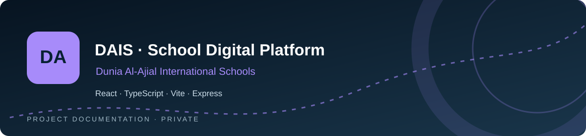
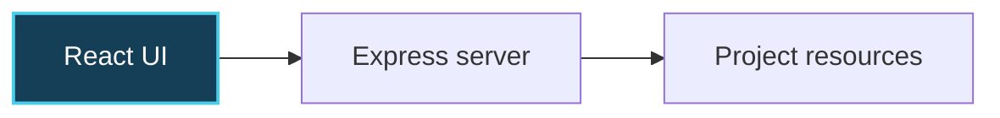

# DAIS · School Digital Platform

**Dunia Al-Ajial International Schools**

  

[**Repository overview ↗**](https://github.com/a7mdel5taeeb-eng/dais) · [**Architecture ↓**](#-architecture-at-a-glance) · [**Project notes ↓**](#-original-project-documentation)

---

## ✨ Overview · نبذة عن المشروع

**Private school application**

The repository contains a school-oriented web app with React pages and translation resources. It includes server code and AI integration dependencies. No public website URL or production deployment is claimed.

| | Focus area |
|:--:|:--|
| 🧭 | Bilingual resources |
| 🧩 | Reusable pages |
| 🌐 | School-focused interface |
| ⚙️ | Application server |

**Core stack:** React · TypeScript · Vite · Express

## 🧠 Architecture at a glance

*Conceptual project map — not a claim of production deployment or complete infrastructure.*

## 📂 Repository map

`src/` · `public/` · `server.ts` · `package.json` · `vite.config.ts`

## 🛡️ Working principles

- Preserve existing working functionality and keep application changes separate from documentation updates.
- Run the relevant project checks before merging application changes.
- Do not commit credentials, private customer/school data, or local environment files.
- Validate bilingual layouts, accessibility and mobile behavior where applicable.

---

## 📚 Original project documentation

The established README content below is intentionally preserved, including the project's setup instructions, detailed notes, and historical checkpoints.

---

# Run and deploy your AI Studio app

This contains everything you need to run your app locally.

View your app in AI Studio: https://ai.studio/apps/2925d8a9-dda3-490a-9935-1c442935cd1e

## Run Locally

**Prerequisites:**  Node.js

1. Install dependencies:
   `npm install`
2. Set the `GEMINI_API_KEY` in [.env.local](.env.local) to your Gemini API key
3. Run the app:
   `npm run dev`
